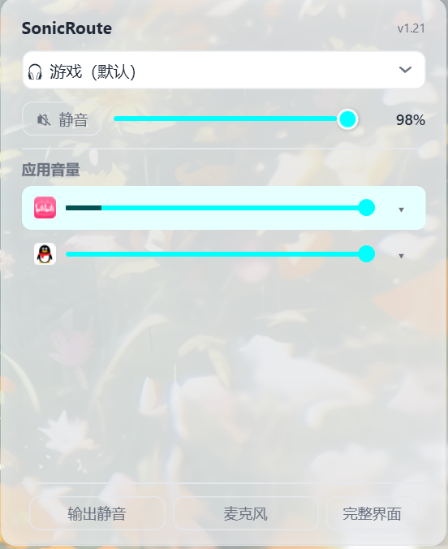
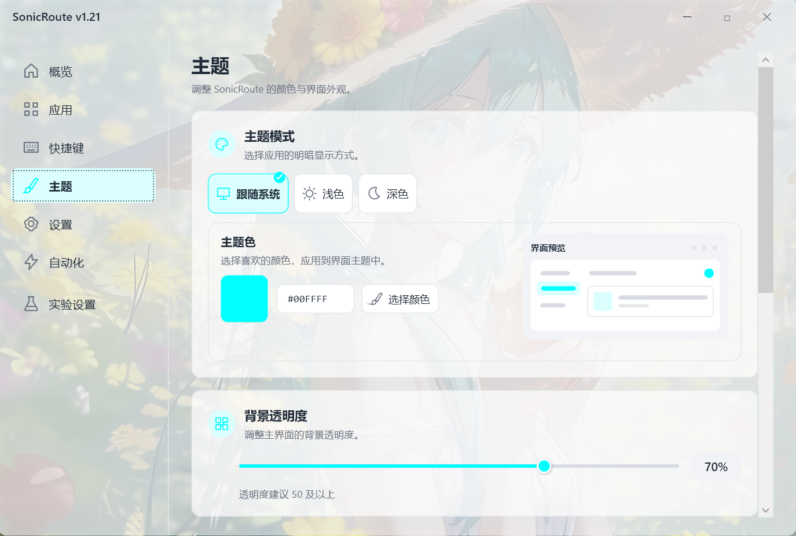

<!-- Generated from docs/readme/shared.json and docs/readme/locales/zh-CN.json. Edit those sources, then run node docs/readme/generate.cjs. -->
# 🎧 音跃 SonicRoute

**简体中文** | [English](README.en.md) | [繁體中文](README.zh-TW.md) | [日本語](README.ja.md) | [한국어](README.ko.md) | [Deutsch](README.de.md) | [Français](README.fr.md) | [Español](README.es.md) | [Русский](README.ru.md)

   

**把每个应用的声音，送到你想要的设备。**

SonicRoute 是常驻托盘的 Windows 音频工具：为应用分别选择输出与输入设备，让音乐走音箱，游戏和通话走耳机。用快捷键、托盘区域滚轮或快速面板控制声音，再把常用操作组合成自动化规则。

📥 [下载正式版](https://github.com/kunkunkunQoQ/SonicRoute/releases/latest) · [Microsoft Store](https://apps.microsoft.com/detail/9NQZGRTPM1NT) · [使用指南](https://github.com/kunkunkunQoQ/SonicRoute/wiki/01-%E4%BD%BF%E7%94%A8%E6%8C%87%E5%8D%97) · [Wiki](https://github.com/kunkunkunQoQ/SonicRoute/wiki)

Windows 10 2004+ / Windows 11 · x64 / ARM64（实验） · 九种语言 · MIT 开源

 

界面示例：快捷面板管理应用音量与设备；主题设置调整外观。

## ✨ SonicRoute 的特点

### 核心功能

- **按应用分配声音**：分别设置应用的播放与录音设备，也能切换运行中应用的设备或 Windows 系统默认设备。应用路由由 Windows 保存，退出 SonicRoute 后仍会保留。
- **围绕当前应用操作**：最近使用模式跟随有音频会话的前台应用；也可选择上次操作的应用或指定应用。常用设备可筛选、改名，用同一组快捷键循环切换。
- **快捷键与托盘滚轮**：支持键盘组合、鼠标侧键与滚轮组合；在任务栏托盘区域滚动即可调整当前应用音量。可单独绑定全局麦克风静音，静音所有麦克风。托盘菜单可直接选择系统默认输出设备，并固定当前应用后调节音量、静音或切换路由；也可暂停托盘滚轮调节，设置会跨重启保存。
- **两种面板，各有侧重**：快捷面板逐行管理应用，顶部控制所选输出设备；应用面板集中控制当前应用。配合 OSD 操作提示、应用声音电平和麦克风静音提示，随时确认状态。

### 次要功能

- **一次触发，多步完成**：6种触发、18种操作，可组合设备切换、音量、静音、程序启动、PowerShell 和 OSD；每步可设延时及失败后停止，也能调用另一条规则。`sr "规则名称或ID"` 只向已运行的 SonicRoute 实例提交规则；首次正常启动登记命令后，需重新打开终端。
- **按你的习惯设置**：深浅主题、强调色、透明度与面板位置可调；内置九种语言，支持语言 JSON 导入与导出。

## 🎮 这样使用

 打开游戏时自动切到耳机，或把几步常用操作保存成一条规则。 [配置自动化](https://github.com/kunkunkunQoQ/SonicRoute/wiki/04-%E8%87%AA%E5%8A%A8%E5%8C%96%E8%A7%84%E5%88%99)。

| 你的场景 | SonicRoute 可以做什么 |
|---|---|
| 音乐、游戏和语音软件同时使用 | 为各应用选择不同的输出或输入设备，并分别控制音量 |
| 在耳机与音箱之间切换 | 勾选常用设备，用快捷键循环切换当前应用的设备 |
| 想调整正在使用的应用 | 在最近使用模式下跟随有音频会话的前台应用，通过快捷键或托盘滚轮调节 |
| 每次打开某个应用都要重复设置 | 用应用启动触发规则，依次设置设备、音量和其他操作 |
| 用脚本或其他工具调用音频场景 | 创建多步规则，再用 `sr "规则名称或ID"` 调用 |

## 🚀 下载与开始使用

**当前正式版：[v1.23](https://github.com/kunkunkunQoQ/SonicRoute/releases/tag/v1.23)** · 2026-10-15 · [更新说明](docs/release-v1.23.md)

普通 Windows x64 用户可优先选择 Microsoft Store，方便安装与自动更新；希望使用单个 EXE 可选择 Lite x64；不方便安装 .NET 8 时可选择 Legacy x64。上方“下载正式版”始终指向最新发布；下表 Lite 与 Legacy 的下载链接对应 v1.23，商店版本以在架版本为准。

| 版本 | 下载 | 运行要求 |
|---|---|---|
| Lite x64 | [单个 EXE](https://github.com/kunkunkunQoQ/SonicRoute/releases/download/v1.23/SonicRoute-v1.23-Lite-x64.exe) | 与程序架构匹配的 x64 .NET 8 Desktop Runtime |
| Lite ARM64（实验） | [单个 EXE](https://github.com/kunkunkunQoQ/SonicRoute/releases/download/v1.23/SonicRoute-v1.23-Lite-arm64.exe) | 与程序架构匹配的 ARM64 .NET 8 Desktop Runtime |
| Legacy x64 | [完整 ZIP](https://github.com/kunkunkunQoQ/SonicRoute/releases/download/v1.23/SonicRoute-v1.23-Legacy-x64.zip) | .NET Framework 4.8；完整解压后运行 |
| Microsoft Store | [商店安装](https://apps.microsoft.com/detail/9NQZGRTPM1NT) | x64；支持自动更新，以商店在架版本为准 |

Lite 请安装对应架构的 [.NET 8 Desktop Runtime](https://dotnet.microsoft.com/download/dotnet/8.0)。Legacy 无需安装 .NET 8。

1. 启动后在系统托盘找到 SonicRoute（可能位于隐藏图标中），双击图标打开完整界面。
2. 在「设置 → 保留的设备」勾选常用输出与输入设备。
3. 单击托盘打开快速面板，或到快捷键页设置操作；需要组合操作时再创建自动化规则。

`sr` 只连接已运行的 SonicRoute 实例，不会启动软件。首次使用前，先正常启动软件登记命令，再关闭并重新打开终端。设备切换遇到问题时，可按 [常见问题](https://github.com/kunkunkunQoQ/SonicRoute/wiki/06-%E5%B8%B8%E8%A7%81%E9%97%AE%E9%A2%98) 排查。

1.23 新增托盘直选系统默认输出、固定当前应用的音量/静音/路由控制、全部麦克风静音，以及可跨重启保存的托盘滚轮暂停设置。系统默认音量的默认快捷键为 Ctrl+Alt+Shift+滚轮，与控制当前应用的默认快捷键 Ctrl+Alt+滚轮区分。设置开关布局调整，页面改为按需加载。旧版变化见 [版本历史](https://github.com/kunkunkunQoQ/SonicRoute/wiki/09-%E7%89%88%E6%9C%AC%E5%8E%86%E5%8F%B2)。

## 📚 使用文档

| 想了解什么 | 文档 |
|---|---|
| 安装、面板与常见操作 | [使用指南](https://github.com/kunkunkunQoQ/SonicRoute/wiki/01-%E4%BD%BF%E7%94%A8%E6%8C%87%E5%8D%97) · [功能特性](https://github.com/kunkunkunQoQ/SonicRoute/wiki/02-%E5%8A%9F%E8%83%BD%E7%89%B9%E6%80%A7) |
| 默认按键、录制与作用范围 | [快捷键](https://github.com/kunkunkunQoQ/SonicRoute/wiki/03-%E5%BF%AB%E6%8D%B7%E9%94%AE) |
| 触发条件、多步操作与脚本调用 | [自动化规则](https://github.com/kunkunkunQoQ/SonicRoute/wiki/04-%E8%87%AA%E5%8A%A8%E5%8C%96%E8%A7%84%E5%88%99) · [命令行](https://github.com/kunkunkunQoQ/SonicRoute/wiki/05-%E5%91%BD%E4%BB%A4%E8%A1%8C%E6%89%A7%E8%A1%8C%E8%A7%84%E5%88%99) |
| 安装与功能排障 | [常见问题](https://github.com/kunkunkunQoQ/SonicRoute/wiki/06-%E5%B8%B8%E8%A7%81%E9%97%AE%E9%A2%98) |
| 源码、构建与版本记录 | [技术实现](https://github.com/kunkunkunQoQ/SonicRoute/wiki/07-%E6%8A%80%E6%9C%AF%E5%AE%9E%E7%8E%B0) · [版本相关](https://github.com/kunkunkunQoQ/SonicRoute/wiki/08-%E7%89%88%E6%9C%AC%E7%9B%B8%E5%85%B3) · [版本历史](https://github.com/kunkunkunQoQ/SonicRoute/wiki/09-%E7%89%88%E6%9C%AC%E5%8E%86%E5%8F%B2) |

## 📌 后续计划

- **v1.24 · 性能与稳定性**：继续改善后台资源占用、响应速度与兼容性。
- **后续阶段**：根据反馈持续完善现有功能。计划可能随反馈调整。

[提交建议或问题](https://github.com/kunkunkunQoQ/SonicRoute/issues/new/choose)。

## 🧩 其他作品与组合用法

- **[SilentPlayer](https://github.com/kunkunkunQoQ/SilentPlayer)**：Windows 音频播放器；可搭配自动化「启动程序」实现按键播放音效。 [查看组合教程](https://github.com/kunkunkunQoQ/SonicRoute/wiki/01-%E4%BD%BF%E7%94%A8%E6%8C%87%E5%8D%97#52-%E7%BB%84%E5%90%88%E5%9C%BA%E6%99%AFsilentplayer-%E9%9F%B3%E6%95%88%E6%9D%BF%E7%B1%BB%E4%BC%BC-soundpad)
- **[WinAudioRoute](https://github.com/kunkunkunQoQ/WinAudioRoute)**：Windows 音频控制库（.NET），提供设备、会话、按应用路由、事件与 CLI。

---

感谢使用 SonicRoute。 [查看文档](https://github.com/kunkunkunQoQ/SonicRoute/wiki) · [反馈问题](https://github.com/kunkunkunQoQ/SonicRoute/issues)。

**作者主页：[哔哩哔哩](https://b23.tv/TDqSAKM) | [爱发电](https://www.ifdian.net/a/koukou021) | [GitHub](https://github.com/kunkunkunQoQ)**
